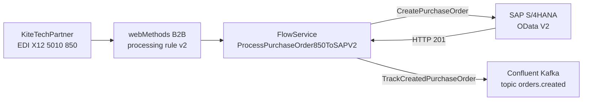

# B2B Order Processing Demo: webMethods B2B + Integration + SAP + Kafka

Demo assets for Jira ticket **POLARIS-2784** ("Solution Authoring use case – Spec-Driven Development").
Kite Sports receives EDI X12 5010 850 Purchase Orders from retail partners. IBM Bob reads the Jira
requirement and builds the integration end to end through the Intelligence Hub, using the playbook in
this repo.

## Flow



1. A partner sends an 850 Purchase Order to webMethods B2B.
2. Rule `KiteTechPartner_PurchaseOrder_850_ProcessingRulev2` matches sender, receiver and document type,
   and calls the FlowService.
3. The FlowService creates the purchase order in SAP S/4HANA with the custom action `CreatePurchaseOrder`.
4. On SAP status `201`, it publishes `poNumber`, `sapOrderId`, `totalAmount` and `timestamp` to Kafka
   topic `orders.created` with `TrackCreatedPurchaseOrder`, for live orders-per-minute analytics.

## Repository contents

| Path | Purpose |
|---|---|
| [`script.md`](script.md) | Demo transcript: persona, walkthrough, and the sample 850 payload (section 7) |
| [`.bob/skills/b2b-sap-kafka-po-integration/SKILL.md`](.bob/skills/b2b-sap-kafka-po-integration/SKILL.md) | Bob skill: step-by-step playbook with pitfalls and asset IDs |
| `.bob/mcp.json` | Local MCP server config for the Intelligence Hub (not committed, contains a token) |
| `tmp/` | Scratch files such as the generated FSL (gitignored) |

## Environment

| Item | Value |
|---|---|
| Integration project | `kitesports_solutionauthoring` |
| Accounts | `SAP_HANA_KiteSports_Conn`, `Kafka_KiteSports_Account` |
| Partners | `KiteTechPartner` (sender), `IBM Enterprise` (receiver) |
| Document type | `X12 5010 850` (`WMX12-5010--850---------`) |
| Kafka topic | `orders.created` |
| FlowService | `ProcessPurchaseOrder850ToSAPV2` |

## Prerequisites

- Bob connected to the Intelligence Hub MCP server. Copy your own server URL and token into
  `.bob/mcp.json`; do not commit it.
- Partners, project, accounts, Kafka topic and the custom actions `CreatePurchaseOrder` and
  `TrackCreatedPurchaseOrder` already exist (see the playbook's prerequisites table).
- Access to the Jira ticket through the Atlassian MCP server.

## Run the demo

1. Open Bob and paste the prompt:

   ```
   Analyse the JIRA requirement https://ibm-middleware.atlassian.net/browse/POLARIS-2784 and build the end-to-end integration for the B2B purchase order to SAP S/4HANA and Kafka analytics.
   ```

2. Bob follows the `b2b-sap-kafka-po-integration` skill:
   read Jira, discover assets, author and deploy the FlowService, create the B2B ingress,
   create and activate the processing rule, then submit a test document.
3. Verify the transaction in B2B: the routing log should show the v2 rule selected, followed by a
   successful execution of `ProcessPurchaseOrder850ToSAPV2`. Then check the new purchase order in SAP
   and the message on `orders.created` in Confluent Cloud.

Use the exact sample payload from `script.md` section 7, flattened to one `~`-delimited string. Other ISA
sender and receiver IDs will not resolve to the partners and will miss the rule.

## Known issues

- `create_rule` can save a rule with empty criteria (it would match every document). Check with
  `get_rule` straight after creating it and fix with `update_rule`; the playbook has the exact call.
- `script.md` uses older asset names. The Jira ticket and the playbook (V2 names, `sapOrderId`) take
  precedence.
- The playbook describes the flow and checks, but the SAP and Kafka results are only confirmed in SAP and
  Confluent themselves, not through the B2B log.

## Cleanup

Nothing is removed automatically. To remove the demo assets, set the v2 rule to Inactive, then delete the
FlowService. Leave the pre-existing v1 rule `KiteTechPartner_PurchaseOrder_850_ProcessingRule` as it is.
