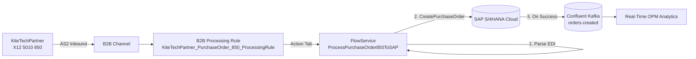

# Resilient B2B Order Processing — webMethods B2B + Integration + SAP + Kafka

### Demo Transcript

---

## Context & Persona

**Hill:** Hill 37 — Productive Use Hill (Solution Authoring & Spec-Driven Development)\
**Persona:** Isaac, Integration Specialist (Technical Builder)\
**Platform:** IBM Integration Intelligence Hub / Polaris Platform (IBM Bob, webMethods B2B, webMethods Integration, SAP S/4HANA OData V2, Confluent Kafka, Context Engine)

Isaac is an integration specialist working at **Kite Sports**, a rapidly expanding wearable technology and smart sports apparel company. As Kite Sports transitions from direct-to-consumer (D2C) to US brick-and-mortar department stores (e.g., Nordstrom, Macy's, Target), trading partners mandate standard **EDI ANSI X12 5010 850 Purchase Order** protocols for automated procurement.

**The ask:** Implement an end-to-end, resilient B2B integration that ingests EDI 850 Purchase Orders via webMethods B2B, validates and maps the order into SAP S/4HANA (`API_SALES_ORDER_SRV`), and emits real-time transaction telemetry to an Apache Kafka cluster (`orders.created`) for live orders-per-minute (OPM) analytics and executive dashboards.

> With Intelligence Hub and IBM Bob, Isaac can author, wire, and deploy complex multi-cloud enterprise integrations in **minutes**, not days.

---

## Demo Walkthrough

### 1\. Setup — Baseline Integration & B2B Estate

Before starting, the presenter confirms the current baseline in the Integration Intelligence Hub:

- **Jira Requirement:** `POLARIS-2784` ("Solution Authoring use case – Spec-Driven Development") is open in the backlog

- **webMethods B2B:** Partner `KiteTechPartner` (Sender) and `IBM Enterprise` (Receiver) exist and are Active

- **webMethods Integration:** Project `kitesports_solutionauthoring` exists with verified accounts:

  - `SAP_HANA_KiteSports_Conn` (SAP S/4HANA Cloud OData V2)

  - `Kafka_KiteSports_Account` (Confluent Cloud Kafka)

- **Target Kafka Topic:** `orders.created` configured for downstream analytics

---

### 2\. Prompt Bob

Isaac initiates the solution authoring by pasting the Jira ticket requirement directly into IBM Bob:

```
Analyse the JIRA requirement https://ibm-middleware.atlassian.net/browse/POLARIS-2784 and build the end-to-end integration for the B2B purchase order to SAP S/4HANA and Kafka analytics.
```

---

### 3\. Bob's Reasoning Process & Context Retrieval

Bob works through the task systematically using the Polaris Context Engine:

1. **Jira MCP Lookup:** Reads `POLARIS-2784` to extract functional requirements, business schemas, and target systems.

2. **Context Engine Discovery:** Queries active integration assets:

   - Identifies existing partner `KiteTechPartner` (`m1ajl700k4v7fj3f0000007p`) and enterprise receiver `IBM Enterprise`.

   - Confirms SAP connection `SAP_HANA_KiteSports_Conn` and Kafka account `Kafka_KiteSports_Account`.

   - Discovers project container `kitesports_solutionauthoring`.

3. **Dependency & Gap Analysis:** Identifies new assets required vs. existing assets to reuse, surfacing the need for a new B2B Processing Rule and a dedicated FlowService.

4. **Implementation Planning:** Generates an end-to-end architecture plan with a Mermaid orchestration flow and requests approval.



---

### 4\. Authoring the Integration FlowService

Bob authors the Deploy Anywhere FlowService (`ProcessPurchaseOrder850ToSAP`) within project `kitesports_solutionauthoring`:

- **Step 1 — Ingest & Decode:** Receives the inbound EDI 850 payload passed from the B2B gateway.

- **Step 2 — Parse EDI Document:** Calls `wm.b2b.edi:convertToValues` using the ANSI X12 5010 850 document schema.

- **Step 3 — Data Transformation:** Maps EDI segments (`BEG03` PO Number, `N1*BY` Buyer Party, `PO1` Line Items) to SAP OData V2 structure `A_PurchaseOrderType`.

- **Step 4 — Invoke SAP S/4HANA:** Executes `CreatePurchaseOrder` action via `SAP_HANA_KiteSports_Conn`.

- **Step 5 — Conditional Telemetry:** On successful SAP order creation (HTTP 201), publishes order metadata (`poNumber`, `sapSalesOrderId`, `totalAmount`, `timestamp`) to Kafka topic `orders.created` using `Kafka_KiteSports_Account`.

---

### 5\. Configuring B2B Processing Rule & Wiring

Bob connects the B2B edge layer to the newly authored FlowService:

- **Rule Name:** `KiteTechPartner_PurchaseOrder_850_ProcessingRule`

- **Match Criteria:**

  - **Sender:** `KiteTechPartner`

  - **Receiver:** `IBM Enterprise`

  - **Document Standard:** `ANSI X12`

  - **Document Type / Version:** `5010 850`

- **Action Configuration:** Sets action type to `Integration` and assigns `ProcessPurchaseOrder850ToSAP` as the target execution handler.

- **Activation:** Sets rule status to **Active** ✅.

---

### 6\. Deployment & Governance Approval

Bob prepares the deployment package and follows governance guardrails:

> ⚠️ Bob requests explicit user confirmation before deploying new services and enabling production rules in `kitesports_solutionauthoring`.

- User provides deployment confirmation ("yes")

- FlowService `ProcessPurchaseOrder850ToSAP` compiled and deployed ✅

- B2B Processing Rule linked and activated ✅

---

### 7\. Functional Testing & Validation

Bob submits a live EDI ANSI X12 5010 850 Purchase Order payload through webMethods B2B to validate the complete pipeline:

```edi
ISA*00*          *00*          *ZZ*SENDERID       *ZZ*RECEIVERID     *261009*1200*U*00501*000000001*0*T*:~
GS*PO*SENDERID*RECEIVERID*20261009*1200*1*X*005010~
ST*850*0001~
BEG*00*NB*1010**20261009~
CUR*BY*AUD~
REF*DP*001~
N1*BY*ABC COMPANY*92*10300081~
N3*100 MAIN STREET~
N4*BANGALORE*KA*560001*IN~
N1*ST*ABC COMPANY WAREHOUSE*92*WH001~
N3*200 WAREHOUSE ROAD~
N4*BANGALORE*KA*560100*IN~
PO1*1010*2*PC*160.00**BP*ELEC-TV-055-LED*VP*SUPPELEC-TV-055-LED~
PID*F****Widget A~
CTT*1~
SE*14*0001~
GE*1*1~
IEA*1*000000001~
```

**Validation Checks Performed:**

| Check                       | Target System         | Expected Result                                          | Outcome                  |
|---------------------------|---------------------|--------------------------------------------------------|------------------------|
| B2B Ingestion & Routing     | webMethods B2B        | Matched KiteTechPartner_PurchaseOrder_850_ProcessingRule | ✅ Envelope & Doc Routed  |
| EDI Parsing & Mapping       | FlowService Engine    | X12 5010 850 parsed into structured 850_DT               | ✅ Transformation Success |
| SAP Order Creation          | SAP S/4HANA OData V2  | Sales Order created via SAP_HANA_KiteSports_Conn         | ✅ HTTP 201 Created       |
| Kafka Event Telemetry       | Confluent Cloud Kafka | Event published to topic orders.created                  | ✅ Payload on Topic       |
| Error Handling / Resilience | Flow Logic            | No Kafka publish on SAP failure; zero-loss audit logging | ✅ Verified               |

---

### 8\. Verification — End-to-End Analytics & Dashboards

- Returns to the **webMethods B2B Transaction Monitor**: Transaction status confirmed **DONE** with full audit trail.

- Checks **SAP S/4HANA**: Sales Order visible with line items and customer reference `PO-1010`.

- Inspects **Confluent Kafka Topic (`orders.created`)**: Real-time event consumed by executive OPM dashboard.

---

## Summary

| Step                  | Tool / Component             | Outcome                                                                |
|---------------------|----------------------------|----------------------------------------------------------------------|
| Read Requirement      | Jira MCP (POLARIS-2784)      | Extracted B2B-to-ERP spec                                              |
| Asset Discovery       | Polaris Context Engine       | Mapped existing accounts and B2B partner identities                    |
| FlowService Authoring | webMethods Integration / Bob | Authored and compiled ProcessPurchaseOrder850ToSAP                     |
| B2B Rule Wiring       | webMethods B2B               | Created and activated KiteTechPartner_PurchaseOrder_850_ProcessingRule |
| ERP Integration       | SAP S/4HANA OData V2         | Successfully posted deep-insert sales orders                           |
| Analytics Telemetry   | Confluent Cloud Kafka        | Published telemetry to orders.created topic                            |
| End-to-End Testing    | Bob + B2B Audit Logs         | Full automated validation verified                                     |
